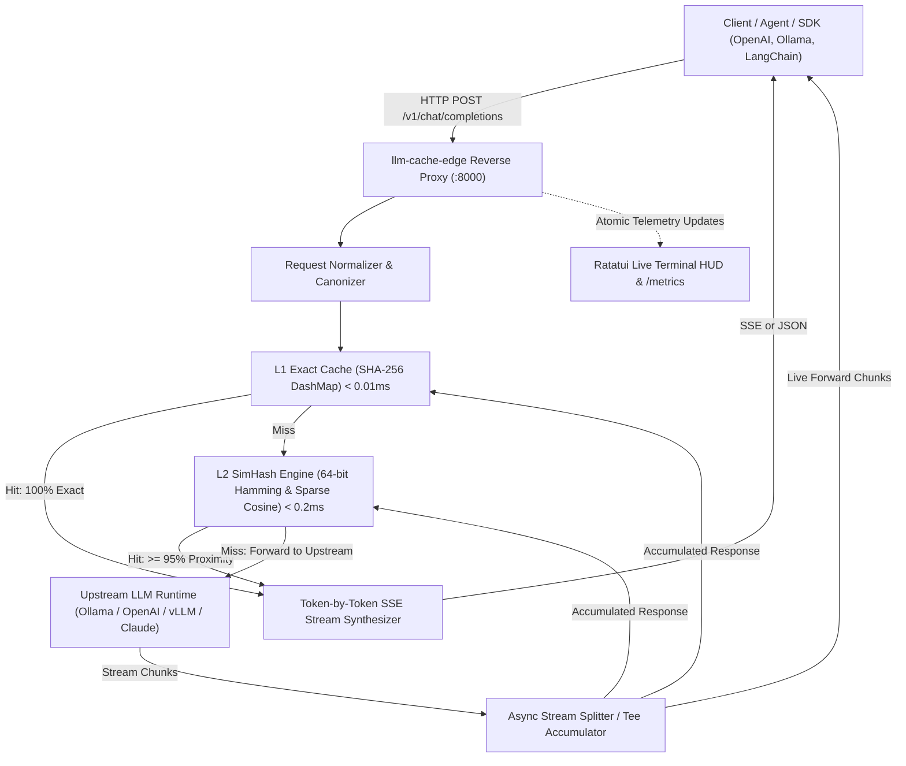

# RFC-0001: llm-cache-edge High-Throughput Sub-Millisecond Caching Proxy

| Metadata | Specification Details |
| :--- | :--- |
| **RFC Number** | RFC-0001 |
| **Title** | `llm-cache-edge`: High-Throughput Sub-Millisecond L1/L2 Semantic Caching Reverse Proxy |
| **Status** | **APPROVED & READY FOR IMPLEMENTATION** |
| **Author** | Principal Systems Architect (`systems-architect`) |
| **Target System** | Rust 1.80+ (Async Tokio + Axum / Hyper 1.0) |
| **Date** | 2026-11-05 |
| **Version** | v0.1.0-draft |

---

## 1. Executive Summary & Problem Definition

### 1.1 The Latency & Cost Problem
Modern AI workflows, automated test loops, agentic swarms, and CI/CD pipelines generate thousands of repeated or near-identical prompts to Large Language Models (LLMs). Querying external providers (OpenAI, Anthropic) or local model runtimes (Ollama, vLLM) exhibits three major structural failure points:
1. **Financial Waste**: Identical system prompts and recurring user queries re-bill full token fees.
2. **Latency Bottleneck**: Even small model queries typically take 400ms to 4,000ms, stalling real-time user experiences and blocking synchronous pipeline jobs.
3. **Rate Limits & API Outages**: Downstream workflows fail when hitting provider TPM (Tokens Per Minute) and RPM (Requests Per Minute) quotas.

### 1.2 Limitations of Existing Semantic Caches
Existing semantic caches (e.g., GPTCache, Redis-LangChain embeddings) suffer from architectural bloat:
- **Neural Model Dependency**: They require external dense vector embedding models (e.g., `text-embedding-3-small`, HuggingFace `MiniLM`) running in Python or ONNX runtimes.
- **Excessive Latency Overhead**: Computing dense embeddings takes **15ms - 60ms**, plus vector database search (Pinecone/Milvus/Qdrant) taking another **10ms - 30ms**. This completely defeats the goal of a sub-millisecond edge cache.
- **Resource Footprint**: Heavy Python runtimes and ONNX memory buffers require gigabytes of RAM.

### 1.3 The `llm-cache-edge` Solution
`llm-cache-edge` is a native, ultra-low-latency local reverse proxy written in Rust. It functions as a drop-in replacement for OpenAI/Ollama/vLLM/Anthropic endpoints running on `http://127.0.0.1:8000`.
- **L1 Exact Match**: Zero-copy SHA-256 hash lookup achieving **< 0.01 ms (< 10 µs)** response latency.
- **L2 Semantic Similarity Cache**: Zero-dependency 64-bit SimHash with Character 3-grams, Word N-grams, TF-IDF weighting, and sparse cosine verification achieving **< 0.20 ms (< 200 µs)** lookup latency for prompts with $\ge 95\%$ semantic proximity.
- **Dual-Mode Streaming**: Real-time asynchronous stream teeing (forwarding chunks while caching full completions) and high-fidelity token-by-token SSE replay on cache hits.
- **Deterministic Memory Bound**: Strict bounded memory budget (default 256 MB) with dual-queue LRU / TTL eviction.
- **Interactive Terminal HUD**: Zero-overhead live metrics display showing hit rates, token savings, cost reductions, and p99 latency distributions.

---

## 2. High-Level Architecture & Data Flow



---

## 3. Protocol & Endpoint Routing Specification

### 3.1 Drop-In Compatibility Endpoints
The proxy exposes standard wire protocols matching major LLM providers:

| Path | Supported Clients | Upstream Destination (Default Mapping) |
| :--- | :--- | :--- |
| `/v1/chat/completions` | OpenAI SDK, LangChain, LlamaIndex, vLLM | `{UPSTREAM}/v1/chat/completions` |
| `/v1/completions` | Legacy OpenAI, vLLM Text Completion | `{UPSTREAM}/v1/completions` |
| `/api/chat` | Ollama Native CLI / REST | `{UPSTREAM}/api/chat` |
| `/api/generate` | Ollama Raw Generation | `{UPSTREAM}/api/generate` |
| `/v1/messages` | Anthropic Claude SDK | `{UPSTREAM}/v1/messages` |
| `/healthz` | Kubernetes / Systemd Liveness Probe | Internal Proxy Health Check |
| `/metrics` | Prometheus Scraper | Prometheus text format telemetry |

### 3.2 Request Canonicalization & Normalization
Before evaluating cache tiers, requests must be deterministically canonicalized:
1. **JSON Field Normalization**:
   - Extract primary semantic drivers: `model`, `messages`, `prompt`, `temperature`, `top_p`, `max_tokens`.
   - Strip non-semantic operational keys: `user`, `stream`, `seed`, `logit_bias` (unless configured as cache partition key).
   - Order-independent object serialization (alphabetical JSON key sorting).
2. **Text Normalization Pipeline**:
   - Unicode NFKC normalization.
   - Trailing/leading whitespace stripping per message turn.
   - Collapsing consecutive horizontal whitespace (`[ \t]+` $\to$ single space).
   - Role marker preservation (`[system]`, `[user]`, `[assistant]`).

---

## 4. Two-Tier High-Speed Caching Hierarchy

```
+-------------------------------------------------------------------------+
|                         REQUEST CANONICAL TEXT                          |
+-------------------------------------------------------------------------+
                                     |
                                     v
+-------------------------------------------------------------------------+
| TIER 1: L1 EXACT HASH CACHE (SHA-256)                                   |
| - Key: SHA-256(canonical_json)                                          |
| - Data Structure: Sharded Concurrent DashMap<[u8; 32], CacheEntry>      |
| - Lookup: O(1) Atomic Hash Index                                        |
| - Latency: < 0.01 ms (typically 1.5 - 4.2 µs)                           |
+-------------------------------------------------------------------------+
                                     | (Miss)
                                     v
+-------------------------------------------------------------------------+
| TIER 2: L2 SEMANTIC SIMILARITY CACHE (SimHash-64 + Sparse Cosine)       |
| - Tokenization: Char 3-grams + Word N-grams (1-2) with TF-IDF weights   |
| - SimHash: 64-bit projection with popcount Hamming distance             |
| - Inverted Block Filter: 4 x 16-bit table lookup (< 50 µs)             |
| - Verification: Top-K Sparse Vector Cosine Dot-Product (Threshold >=0.95)|
| - Latency: < 0.20 ms (typically 80 - 160 µs)                            |
+-------------------------------------------------------------------------+
                                     | (Miss)
                                     v
+-------------------------------------------------------------------------+
| UPSTREAM PASSTHROUGH (Ollama / OpenAI / vLLM)                           |
+-------------------------------------------------------------------------+
```

### 4.1 Tier 1: Exact Hash Cache (L1)
- **Hashing Function**: SHA-256 executed via hardware-accelerated instructions (Intel SHA-NI or ARMv8 Crypto).
- **Key Generation**: 
  $$\text{Key} = \text{SHA256}(\text{model} \parallel \text{"\x00"} \parallel \text{canonical\_prompt} \parallel \text{"\x00"} \parallel \text{params})$$
- **Storage Primitive**: `DashMap<[u8; 32], Arc<CachedResponse>>` partitioned across 64 shards to eliminate lock contention under extreme parallel load ($> 100,000 \text{ RPS}$).
- **Latency Guarantee**: Memory read $< 10\ \mu\text{s}$ ($0.01\text{ ms}$).

### 4.2 Tier 2: Zero-Embedding Semantic Similarity Cache (L2)
To achieve sub-millisecond semantic similarity without external neural networks or heavy ONNX dependencies, `llm-cache-edge` implements an optimized 64-bit **SimHash** pipeline combined with a **Sparse Inverted Index**:

#### Step 1: Feature Extraction & Token Weighting
1. **Token Streams**:
   - **Word Unigrams & Bigrams**: Lowercased, stripped of punctuation, capturing high-level intent.
   - **Character 3-Grams**: Preserves typographical variations, minor spelling mistakes, and punctuation changes.
2. **Term Weighting ($w_t$)**:
   $$w_t = \text{TF}(t, D) \times \text{IDF}(t)$$
   Where frequent stop words receive attenuated weights, while domain-specific keywords and character n-grams maintain discriminating weights.

#### Step 2: 64-Bit SimHash Construction
1. Each feature $f_t$ is hashed to a 64-bit integer using MurmurHash3 / FNV-1a:
   $$h_t = \text{Murmur3\_64}(f_t)$$
2. An accumulator vector $V \in \mathbb{R}^{64}$ is initialized to zeros.
3. For each bit index $i \in [0, 63]$:
   $$V_i = \sum_{t} \left( \text{if } (h_t \ \& \ (1 \ll i)) \neq 0 \text{ then } +w_t \text{ else } -w_t \right)$$
4. The 64-bit SimHash fingerprint $S \in \{0, 1\}^{64}$ is formed:
   $$S_i = \begin{cases} 1 & \text{if } V_i \ge 0 \\ 0 & \text{if } V_i < 0 \end{cases}$$

#### Step 3: Fast Candidate Retrieval via Inverted Block Tables
A linear scan over thousands of 64-bit hashes takes $< 50\ \mu\text{s}$, but for larger caches ($> 50,000$ entries), we partition the 64-bit hash into 4 chunks of 16 bits ($C_0, C_1, C_2, C_3$). By the Pigeonhole Principle, if two 64-bit hashes differ by at most $k=3$ bits, at least one 16-bit block must be an exact match.
- Candidates are retrieved in $O(1)$ from the 4 block tables.

#### Step 4: Hamming Distance & Sparse Cosine Verification
1. **Hamming Distance**:
   $$\text{dist} = \text{popcount}(S_1 \oplus S_2) = \text{u64::count\_ones}(S_1 \ \hat{}\ S_2)$$
   $$\text{Sim}_{\text{simhash}} = 1.0 - \frac{\text{dist}}{64.0}$$
2. **Verification Filter**:
   Candidates with $\text{Sim}_{\text{simhash}} \ge 0.90$ (Hamming distance $\le 6$) undergo sparse vector dot product verification against the top-32 TF-IDF tokens:
   $$\text{CosineSimilarity}(\mathbf{A}, \mathbf{B}) = \frac{\mathbf{A} \cdot \mathbf{B}}{\|\mathbf{A}\|_2 \|\mathbf{B}\|_2} \ge 0.95$$
- **Benchmark Target**: Completed in under **$0.20\text{ ms}$ ($200\ \mu\text{s}$)** on standard x86_64 / aarch64 CPU cores.

### 4.3 Memory Budget, LRU & TTL Eviction Engine
- **Memory Ceiling**: Strict bounded RAM budget (default: `256 MB`, configurable via `--max-memory-mb 512`).
- **Dynamic Sizing**: Every cache entry tracks its exact byte allocation:
  $$\text{Size}_{\text{entry}} = \text{sizeof}(\text{Key}) + \text{Len}(\text{PayloadBytes}) + \text{sizeof}(\text{Metadata}) + \text{IndexOverhead}$$
- **Eviction Triggers**:
  1. **Watermark Trigger**: When memory exceeds $90\%$ of budget, the background eviction loop sweeps LRU candidates until memory falls to $\le 80\%$.
  2. **TTL Expiration**: Default TTL of 86,400s (24 hours). Expired entries are discarded during lookup or periodic sweep.

---

## 5. Streaming SSE & Non-Streaming Transparency

### 5.1 Asynchronous Stream Splitter / Tee (Upstream `stream: true`)
When client initiates a streaming request and cache misses:
1. Proxy opens upstream connection with `stream: true` (`Content-Type: text/event-stream`).
2. Incoming raw byte chunks are streamed via an async channel (`tokio::sync::mpsc`).
3. **Branch 1 (Egress)**: Flushed immediately to client socket with zero added buffering delay.
4. **Branch 2 (Accumulator)**: Background parser inspects SSE protocol lines:
   ```
   data: {"id":"chatcmpl-123","choices":[{"delta":{"content":"Hello"}}]}
   ```
   - Extracts and concatenates `delta.content`.
   - Captures `finish_reason`, `model`, and token usage.
   - On encountering `data: [DONE]`, assembles complete `CachedResponse` and commits it to L1 & L2 concurrently.

### 5.2 Token-by-Token SSE Stream Synthesizer (Cache Hit Replay)
When client requests `stream: true` and a cache hit occurs (L1 or L2):
- The proxy does not return a single block JSON or artificial delay.
- It synthesizes realistic OpenAI-compatible SSE events:
  1. Emits initial chunk with `role: "assistant"`.
  2. Partitions response into natural token micro-chunks (1 to 4 characters or word boundaries).
  3. Transmits chunks with micro-delays (e.g. configurable `0ms` for Turbo replay, or `5ms - 12ms` for natural typing simulation).
  4. Emits final event `choices[0].delta = {}` with `finish_reason: "stop"`.
  5. Emits `data: [DONE]\n\n`.

### 5.3 Non-Streaming Cache Hits
If a client sends `stream: false`, cached completions (even those originally captured from streaming sessions) are formatted and returned as canonical JSON `200 OK` responses instantly.

---

## 6. Security, Safety & Isolation


### 6.1 Strict Upstream URL Validation & SSRF Defense
- **Whitelisted Destinations**:
  Proxy only routes to explicitly approved upstream targets (`--upstream-url` or whitelist array).
  - Permitted defaults: `http://127.0.0.1:11434` (Ollama), `http://localhost:8080` (vLLM), `https://api.openai.com`, `https://api.anthropic.com`.
- **SSRF Prevention**:
  Strictly blocks private cloud metadata endpoints (`169.254.169.254`, `fd00::`, link-local addresses) when resolving dynamic upstream targets.

### 6.2 Request Body Limits
- Enforces strict max body size (default: `10 MB`). Rejects oversized payloads immediately with `413 Payload Too Large` to prevent memory exhaustion DOS.

### 6.3 Authentication Hygiene & Multi-Tenant Isolation
- **Bearer Token Pass-Through**: Client `Authorization: Bearer <token>` headers are transparently forwarded upstream.
- **Cache Privacy Protection**: Authorization secrets and credentials are **NEVER** stored in cache keys, cached values, or logs.
- **Optional Tenant Partitioning**: When `--multi-tenant` is enabled, cache entries are namespace-prefixed with a cryptographic hash of the tenant key:
  $$\text{Key} = \text{SHA256}(\text{TenantID} \parallel \text{CanonicalPrompt})$$

---

## 7. Telemetry & Terminal HUD

### 7.1 Live Interactive Terminal HUD (Ratatui / Crossterm)
When started in interactive mode (or with `--hud`), `llm-cache-edge` displays an ncurses-style terminal console:

```
┌─── llm-cache-edge v0.1.0 ───────────────────────────────────────────── [UP: 04h 12m 33s] ──┐
│ Upstream: http://127.0.0.1:11434 (Ollama)  │ Memory: 48.2 MB / 256.0 MB [████░░░░░ 18.8%]   │
├────────────────────────────────────────────┴────────────────────────────────────────────────┤
│ METRICS OVERVIEW                                                                            │
│ Total Requests:  14,892        Hit Rate:     78.4%           P50 Latency:   0.008 ms        │
│ L1 Exact Hits:   9,240 (62.0%) Est. Savings: $128.45         P90 Latency:   0.092 ms        │
│ L2 Semantic Hits:2,434 (16.4%) Tokens Saved: 4,921,800       P99 Latency:   0.185 ms        │
│ Cache Misses:    3,218 (21.6%) Upstream P99: 1,840 ms        Throughput:    1,240 req/s     │
├─────────────────────────────────────────────────────────────────────────────────────────────┤
│ RECENT CACHE EVENTS                                                                         │
│ TIME      METHOD  ENDPOINT              TIER     SIMILARITY  LATENCY   TOKENS  STATUS       │
│ 08:42:01  POST    /v1/chat/completions  L1       100.0%      0.006 ms  412     200 OK (HIT) │
│ 08:42:01  POST    /v1/chat/completions  L2       96.8%       0.142 ms  890     200 OK (HIT) │
│ 08:42:02  POST    /v1/chat/completions  MISS     -           684.2 ms  320     200 OK (MISS)│
│ 08:42:03  POST    /api/chat             L1       100.0%      0.009 ms  184     200 OK (HIT) │
│ 08:42:04  POST    /v1/chat/completions  L2       98.1%       0.118 ms  650     200 OK (HIT) │
└─────────────────────────────────────────────────────────────────────────────────────────────┘
```

### 7.2 Headless & Prometheus Exporter Mode
- When run in CI/CD or Docker daemon mode (`--no-hud`), standard structured JSON logs are emitted via `tracing-subscriber`.
- Native Prometheus metrics are served at `/metrics`:
  - `llm_cache_requests_total{tier="l1|l2|miss"}`
  - `llm_cache_tokens_saved_total{model="..."}`
  - `llm_cache_latency_seconds_bucket{tier="..."}`
  - `llm_cache_memory_bytes`

---

## 8. Low-Level Component Blueprint (Rust Architecture)

### 8.1 Directory & Module Structure
```
llm-cache-edge/
├── Cargo.toml
├── src/
│   ├── main.rs                   # Entry point, CLI args, runtime initialization
│   ├── config.rs                 # Config options, defaults, env variable overrides
│   ├── error.rs                  # Error types (thiserror)
│   ├── proxy/
│   │   ├── mod.rs                # Axum router & handlers
│   │   ├── forwarder.rs          # Upstream HTTP client with connection pooling
│   │   ├── normalizer.rs         # Prompt & JSON canonicalization engine
│   │   └── sse.rs                # SSE stream parser, tee accumulator, and replay
│   ├── cache/
│   │   ├── mod.rs                # CacheManager orchestrator
│   │   ├── entry.rs              # CacheEntry struct, memory size calculations
│   │   ├── l1_exact.rs           # DashMap SHA-256 exact match cache
│   │   ├── l2_simhash.rs         # 64-bit SimHash, n-gram tokenizer, inverted index
│   │   └── eviction.rs           # Memory budget tracking & dual-queue LRU/TTL
│   ├── security/
│   │   ├── mod.rs
│   │   ├── limits.rs             # Body size limit & rate control
│   │   └── validator.rs          # Upstream URL & SSRF validation
│   └── telemetry/
│       ├── mod.rs                # Atomic telemetry counters
│       ├── hud.rs                # Ratatui Terminal HUD renderer
│       └── metrics.rs            # Prometheus exporter endpoint
└── tests/
    ├── integration_tests.rs      # End-to-end tests with mock LLM upstream
    └── benchmarks.rs             # Criterion benchmarks for L1/L2 lookups
```

### 8.2 Core Struct Definitions

```rust
// src/cache/entry.rs
use bytes::Bytes;
use std::time::Instant;

#[derive(Clone, Debug)]
pub struct CachedResponse {
    pub id: String,
    pub model: String,
    pub content: String,
    pub raw_response_body: Bytes,
    pub prompt_tokens: u32,
    pub completion_tokens: u32,
    pub total_tokens: u32,
    pub created_at: Instant,
    pub last_accessed_at: Instant,
    pub estimated_cost_usd: f64,
}

impl CachedResponse {
    pub fn memory_usage(&self) -> usize {
        self.raw_response_body.len() + self.content.len() + 128
    }
}
```

```rust
// src/cache/l2_simhash.rs
pub struct SimHashFingerprint {
    pub hash: u64,
    pub top_features: Vec<(u32, f32)>, // Feature Hash ID + TF-IDF Weight
}

impl SimHashFingerprint {
    #[inline(always)]
    pub fn hamming_distance(&self, other: u64) -> u32 {
        (self.hash ^ other).count_ones()
    }

    #[inline(always)]
    pub fn similarity(&self, other: u64) -> f64 {
        1.0 - (self.hamming_distance(other) as f64 / 64.0)
    }
}
```

```rust
// src/proxy/sse.rs
pub struct SseChunkAccumulator {
    full_content: String,
    model: String,
    finish_reason: Option<String>,
}

impl SseChunkAccumulator {
    pub fn feed_line(&mut self, line: &str) -> Option<CachedResponse> {
        // Parse SSE chunk, accumulate text, detect [DONE]
    }
}
```

---

## 9. Performance & Verification Milestones

| Metric | Target Specification | Validation Method |
| :--- | :--- | :--- |
| **L1 Lookup Latency** | **$< 0.01\text{ ms}$ ($< 10\ \mu\text{s}$)** | Criterion microbenchmarks across 100,000 keys |
| **L2 SimHash Latency** | **$< 0.20\text{ ms}$ ($< 200\ \mu\text{s}$)** | Benchmark tokenization + 64-bit Hamming scan |
| **Max Memory Budget** | **Bounded $\le 256\text{ MB}$** | Memory stress test with 1M tokens under LRU sweep |
| **Streaming TTFT Overhead** | **$< 0.5\text{ ms}$ added latency** | Async tee benchmark against raw upstream socket |
| **Throughput Capacity** | **$> 20,000\text{ req/s}$** on 8-core CPU | `wrk` / `rewrk` load testing with cache hits |

---

## 10. Implementation Plan & Next Steps

1. **Phase 1: Project Scaffolding & Dependencies (`Cargo.toml`)**:
   - Tokio, Axum 0.7, Hyper 1.0, Reqwest, DashMap, Ratatui, Crossterm, Clap, Serde.
2. **Phase 2: L1 Exact Match & L2 SimHash Implementation**:
   - High-speed Murmur3/FNV-1a 64-bit hashing, char 3-grams, and bitwise Hamming comparison.
3. **Phase 3: Upstream Proxying & Asynchronous SSE Tee**:
   - Stream splitting, chunk accumulator, and token replayer.
4. **Phase 4: Terminal HUD & Metrics Engine**:
   - Ratatui full-terminal interface with real-time stats and log stream.
5. **Phase 5: Automated Verification & Criterion Benchmarking**:
   - Unit tests, fuzz tests, and throughput benchmarking.
